# NovaZen

NovaZen is a full-stack e-commerce platform for solar-energy products and related solutions. It brings together a customer storefront, a role- and permission-managed admin console, and a versioned JSON API in one Laravel application.

The application supports product discovery, shopping, checkout, order operations, content management, SEO administration, reporting, customer accounts, notifications, and optional Bangladesh courier integrations.

## Table of contents

- [Screenshots](#screenshots)
- [Features](#features)
- [Technology stack](#technology-stack)
- [Requirements](#requirements)
- [Local installation](#local-installation)
- [Configuration](#configuration)
- [API overview](#api-overview)
- [Development and testing](#development-and-testing)
- [Production checklist](#production-checklist)
- [License](#license)

## Screenshots

These are real UI captures from a local development instance, not mockups. They show the visible viewport, not the entire page or every interaction state. Click an image to open its full-size file. Customer, staff, and subscriber details are blurred in the relevant admin captures. Database-backed content and totals may differ with your data.

### Customer storefront

| Homepage | Shop and product discovery |
| --- | --- |
| [](docs/screenshots/home.png) | [](docs/screenshots/shop.png) |

| Product details | Cart |
| --- | --- |
| [](docs/screenshots/product-detail.png) | [](docs/screenshots/cart.png) |

| Wishlist | Checkout |
| --- | --- |
| [](docs/screenshots/wishlist.png) | [](docs/screenshots/checkout.png) |

| Order tracking | Customer login |
| --- | --- |
| [](docs/screenshots/order-tracking.png) | [](docs/screenshots/customer-login.png) |

| Customer registration | About NovaZen |
| --- | --- |
| [](docs/screenshots/register.png) | [](docs/screenshots/about.png) |

| FAQ | Contact |
| --- | --- |
| [](docs/screenshots/faq.png) | [](docs/screenshots/contact.png) |

### Administration

| Admin dashboard | Product management |
| --- | --- |
| [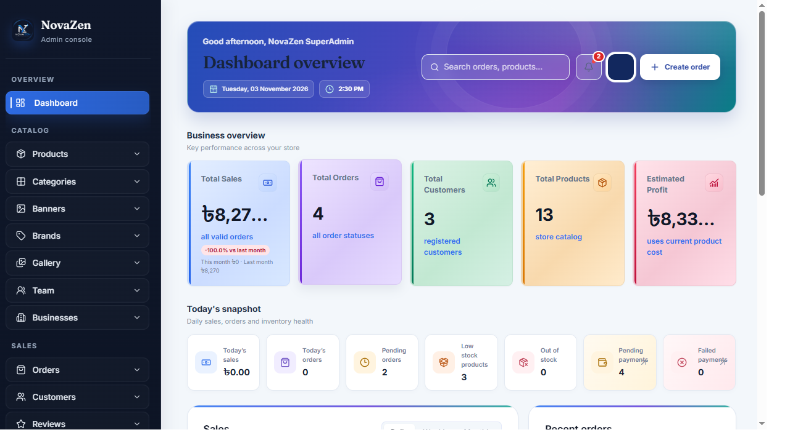](docs/screenshots/admin-dashboard.png) | [](docs/screenshots/admin-products.png) |

| Category management | Product creation |
| --- | --- |
| [](docs/screenshots/admin-categories.png) | [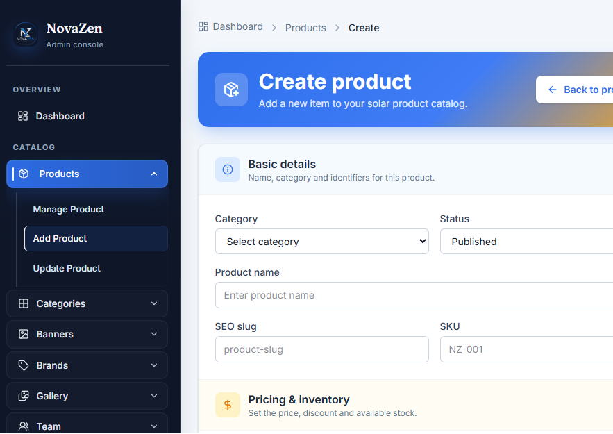](docs/screenshots/admin-create-product.png) |

| Category creation | Brands |
| --- | --- |
| [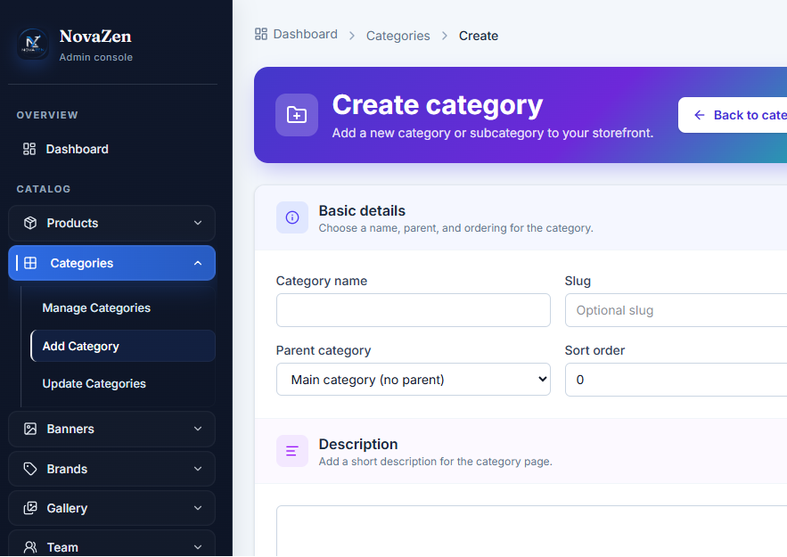](docs/screenshots/admin-create-category.png) | [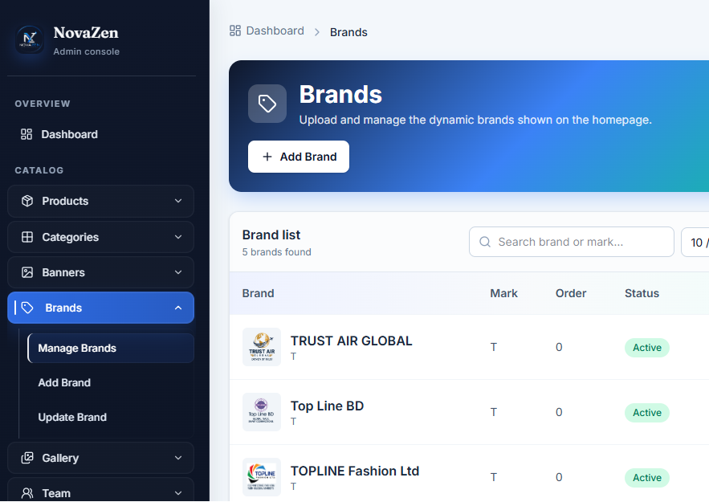](docs/screenshots/admin-brands.png) |

| Banner management | Gallery management |
| --- | --- |
| [](docs/screenshots/admin-banners.png) | [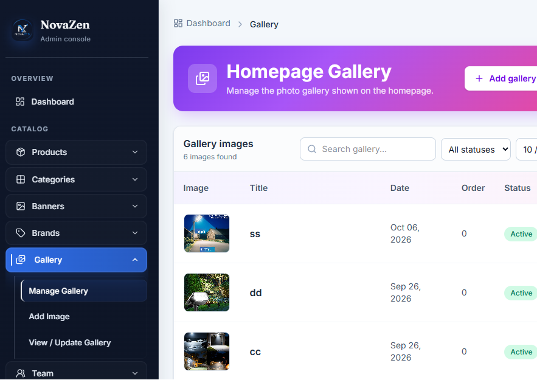](docs/screenshots/admin-gallery.png) |

| Coupons | Order management |
| --- | --- |
| [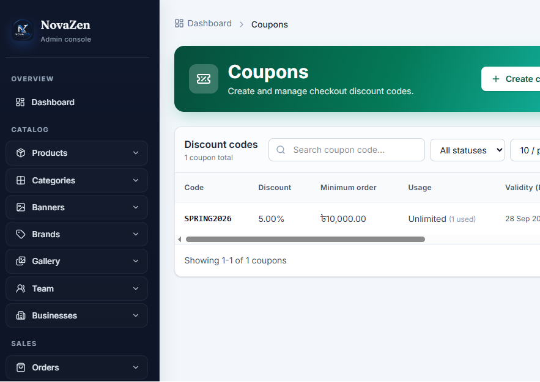](docs/screenshots/admin-coupons.png) | [](docs/screenshots/admin-orders.png) |

| Reports | Create order |
| --- | --- |
| [](docs/screenshots/admin-reports.png) | [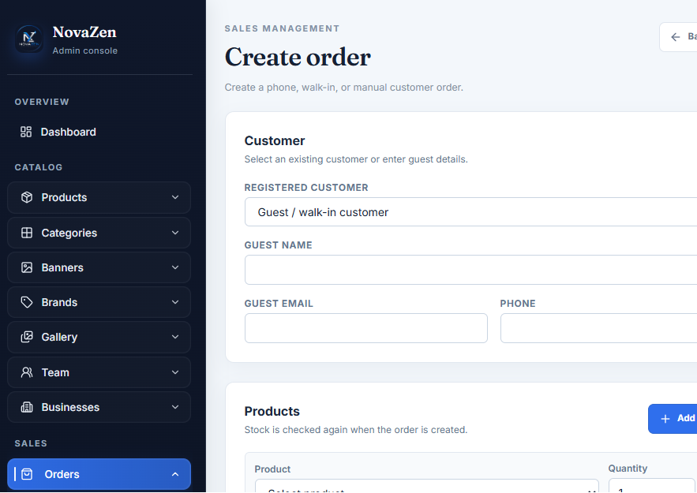](docs/screenshots/admin-create-order.png) |

| Create coupon | Static page SEO |
| --- | --- |
| [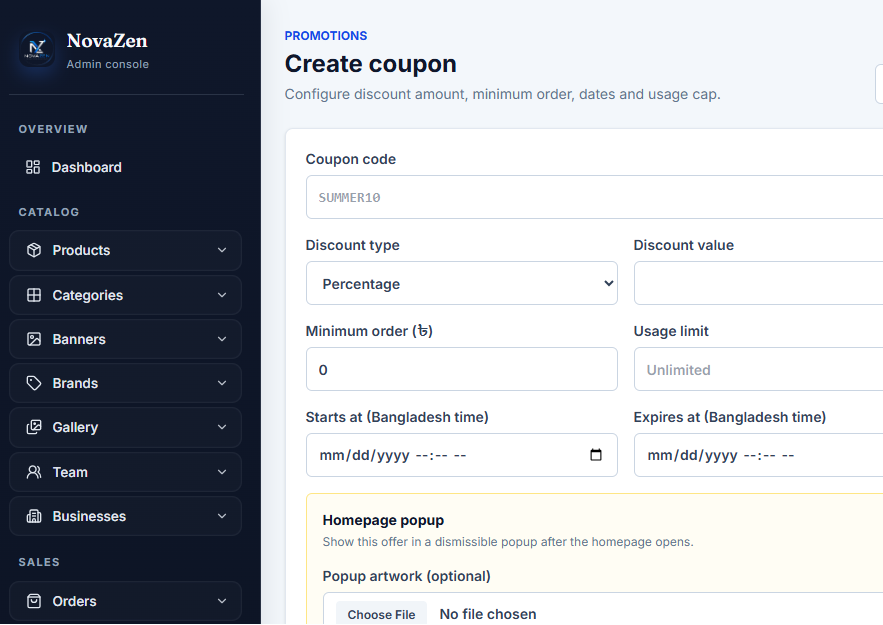](docs/screenshots/admin-create-coupon.png) | [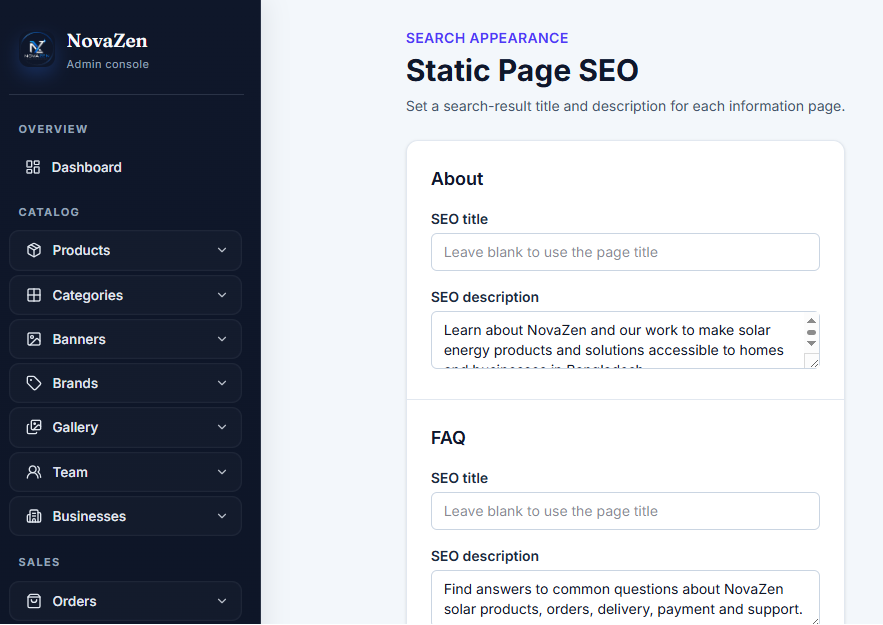](docs/screenshots/admin-static-page-seo.png) |

| Product URL redirects | Customer administration |
| --- | --- |
| [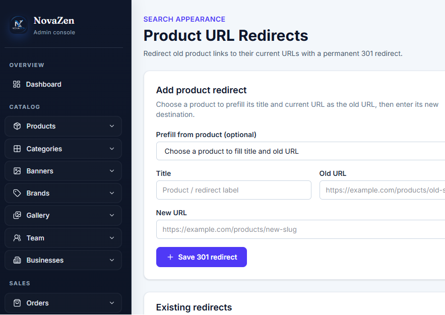](docs/screenshots/admin-product-redirects.png) | [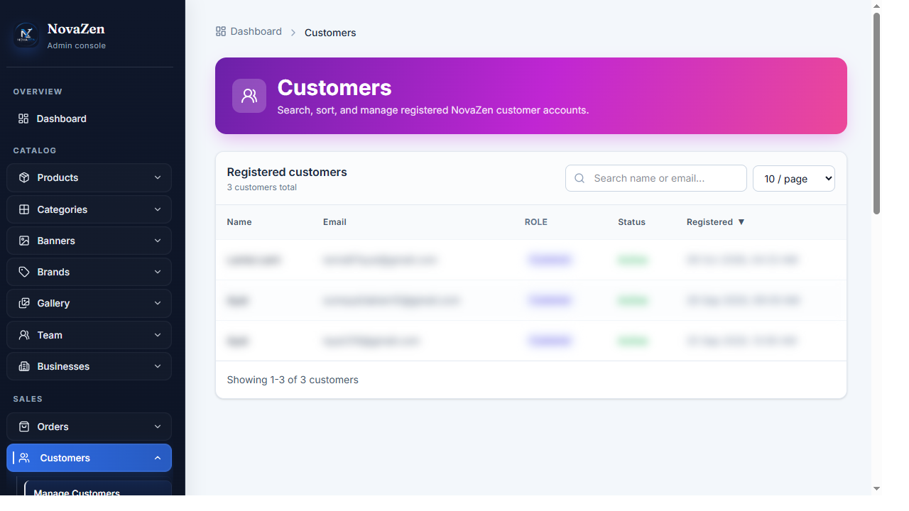](docs/screenshots/admin-customers.png) |

| Staff user management | Contact-message inbox |
| --- | --- |
| [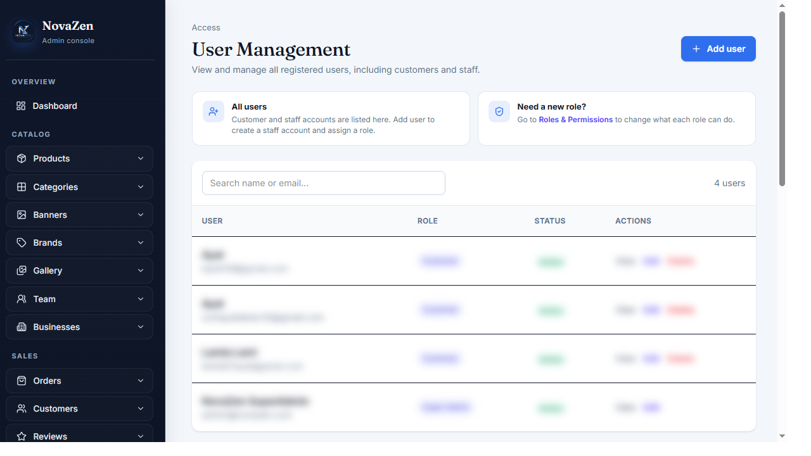](docs/screenshots/admin-users.png) | [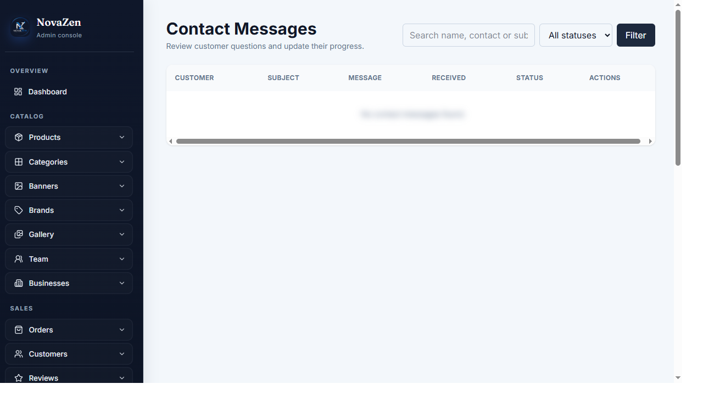](docs/screenshots/admin-contact-messages.png) |

| Newsletter subscribers | Review moderation |
| --- | --- |
| [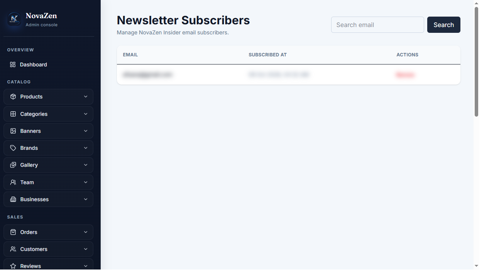](docs/screenshots/admin-newsletter-subscribers.png) | [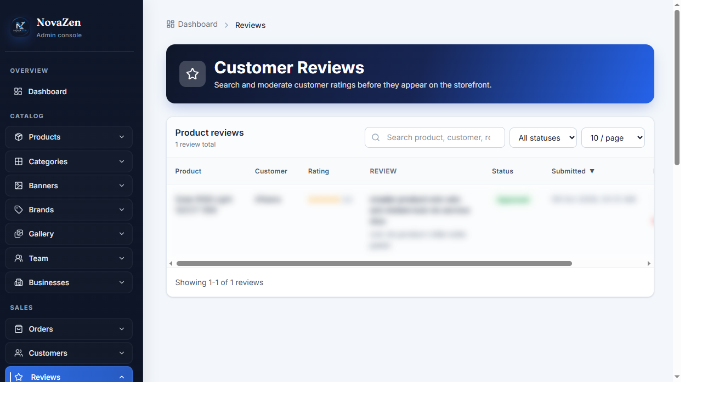](docs/screenshots/admin-reviews.png) |

| Team profiles | Sister businesses |
| --- | --- |
| [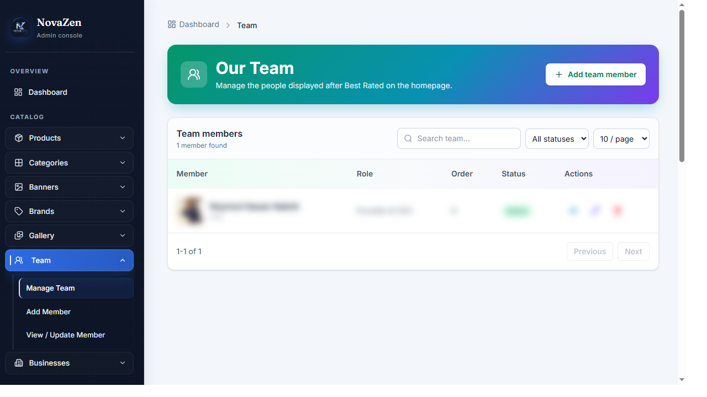](docs/screenshots/admin-team.png) | [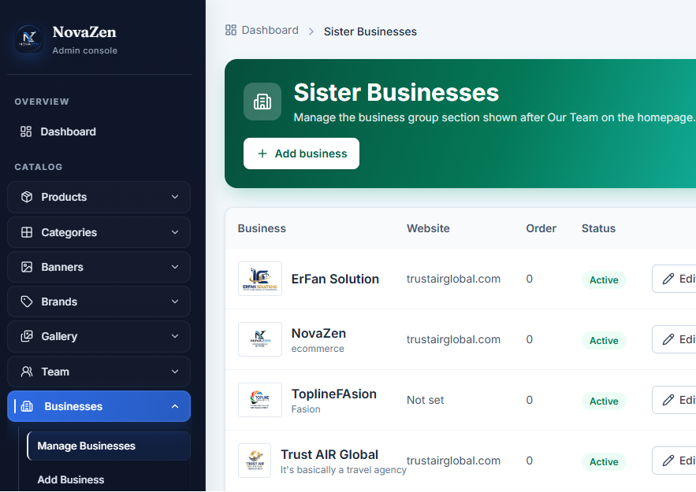](docs/screenshots/admin-businesses.png) |

| Roles and permissions | Admin login |
| --- | --- |
| [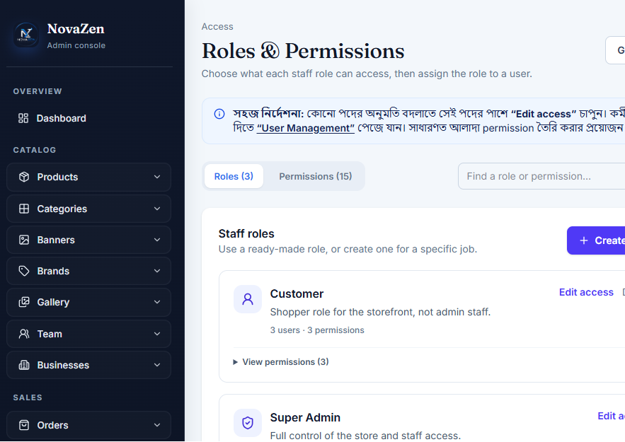](docs/screenshots/admin-roles-permissions.png) | [](docs/screenshots/admin-login.png) |

These 36 images document representative screens, not every feature or state. In particular, the gallery does not currently include dedicated captures for customer account subpages, order detail/invoice/fraud-review screens, or every create/edit form. The feature catalog below describes those workflows from the implemented application; the absence of a screenshot does not imply the feature is missing.

## Features

### Frontend: storefront and product catalog

The customer-facing screens and their supported journeys are:

| Screen or area | Features |
| --- | --- |
| Homepage | Promotional banners, category navigation, featured and top-selling products, flash sales, brands, reviews, team profiles, sister businesses, gallery content, and coupon popups. |
| Shop | Product search by name, SKU, description, or category; nested-category selection; price, rating, and stock filters; and sorting by newest, price, rating, or popularity. |
| Product details | Product images, price and availability, variants, reviews and ratings, product FAQs, related products, add-to-cart and buy-now actions. |
| Cart and wishlist | Guest and signed-in shopping carts, quantity changes, item removal, coupon apply/remove, and wishlist add/remove. |
| Checkout and payment | Guest or customer checkout with delivery/contact details, area- and weight-based shipping, cash on delivery, and the development-only demo online-payment flow. |
| Order confirmation and tracking | Order confirmation, customer order history/detail, order lookup, signed public tracking links, and courier status when available. |
| Customer account | Registration/login, account dashboard, profile and password management, address book, order history/details, and customer notifications. |
| Information and support | About, FAQ, contact form, privacy, terms, shipping, returns, and warranty pages; newsletter signup and floating contact actions. |

- Responsive customer-facing storefront with homepage, shop, product details, about, FAQ, contact, and policy pages.
- Homepage content areas for promotional banners, categories, featured and top-selling products, flash sales, brands, reviews, team information, sister businesses, and gallery content.
- Product catalog with nested categories, brands, variants, SKU, price/compare price, stock quantity, weight, and multiple images.
- Product detail pages with image gallery, availability, reviews and ratings, FAQs, related products, and add-to-cart/buy-now actions.
- Shop search across product name, SKU, descriptions, and category; category selection includes descendant categories.
- Shop filters for maximum price, rating, and stock availability, plus sorting by newest, price, rating, and popularity.
- Offer-zone and flash-sale product sections based on active sale pricing.
- Responsive navigation, floating contact actions, and cart summary in the storefront.
- Product image uploads are stored on Laravel's configured filesystem. When supported GD/WebP functions are available, images can be resized and encoded as WebP; otherwise the original upload is retained.

### Cart, checkout, and orders

- Guest and signed-in customer cart workflows, including quantity updates, item removal, and coupon apply/remove.
- Wishlist add/remove and customer wishlist page.
- Coupon validation and application during shopping and checkout.
- Guest checkout and signed-in customer checkout with delivery/contact information.
- Cash-on-delivery and a demo online-payment flow. The demo payment page is for development/testing and is not a live payment gateway.
- Weight- and area-based shipping calculation. The current service uses a base rate of 70 for Dhaka and 130 outside Dhaka, plus 40 for each started kilogram after the first; review `app/Services/ShippingRateService.php` before changing these rates.
- Order confirmation, order history, order detail pages, and signed public order-tracking links.
- Customer address book and profile/password management.
- Customer order notifications with read, unread, open, and delete actions.
- Product reviews, including guest review support, recommendation flagging, and admin review moderation.

### Admin panel and store operations

The authenticated admin console includes the following areas and workflows:

#### Dashboard

- Store KPIs: sales/revenue, order count, customer and product counts, estimated profit, today's activity, and current-versus-previous-month sales.
- Operational alerts and counts for pending orders, pending/failed payments, unread contact messages, low-stock products, and out-of-stock products.
- Daily, weekly, and monthly sales trends, plus recent orders, top-selling products, low-stock items, and recent contact messages.
- Quick navigation for finding orders/products and creating a manual order.

#### Catalog and merchandising

- **Products:** search by product name, SKU, or category; view product details; create, edit, and delete according to access permissions. Product fields include name, slug, SKU, category, price/discount, weight, stock, descriptions, and draft/published/archived status. Mark products as featured, best seller, flash sale, or picked-for-you. Upload up to five product images with alt text, maintain product FAQs, and configure product SEO/social metadata.
- **Categories:** create, edit, view, search, activate/deactivate, and delete categories; organize nested parent/child categories, images, descriptions, display order, and category SEO. Categories with products or child categories must be cleared before deletion.
- **Brands:** add/edit/delete brands, upload brand logos, set the display mark and sort order, and toggle visibility.
- **Banners:** upload and manage homepage-left, homepage-right, and promotional banners. Configure title, destination link, placement, display order, active status, alternative text, and caption. The homepage-right placement is limited to one banner at a time.
- **Gallery:** upload, crop, preview, view, edit, and delete homepage gallery images; maintain title, alternative text, caption, event date, order, and visibility.
- Product/category/banner/brand/gallery uploads use the configured public storage disk and the application's image optimization service where supported.

#### Promotions and customer feedback

- **Coupons:** create, search, edit, deactivate, and delete discount codes. Configure percentage or fixed discounts, minimum order value, start/end dates, usage limits, active status, and homepage popup behavior, including popup delay and image.
- **Reviews:** search and moderate customer product reviews by approving, rejecting, or returning them to pending; delete reviews when needed.
- **Homepage promotions:** manage active banners, flash-sale placement, popup coupon content, and product merchandising flags that populate storefront sections.

#### Orders, fulfillment, and customers

- **Order list and search:** view and paginate orders; search order number, registered customer name/email, or guest name/email. Filter by order status, payment status, delivery method, guest versus registered customer, and date range. Sort by newest/oldest, order total, or status. The list also provides links to order details and fraud checks.
- **Order details:** inspect line items, customer identity/contact details, shipping address, subtotal, shipping, discounts, grand total, payment method/status and transaction ID, delivery method, courier/tracking information, internal note, and the order event history.
- **Manual order creation:** create an order for an existing customer or a guest. Add available products and quantities, provide guest and shipping details as needed, select payment status/method and standard/express delivery, calculate shipping, reserve stock by decrementing inventory, and send order/low-stock notifications. Eligible unpaid non-COD orders receive the demo payment flow.
- **CSV import/export template:** download a sample template and import order summary rows from CSV. Existing customers can be matched by email; duplicate order numbers are skipped, headers and statuses are checked, and created/skipped totals are reported. The template contains order-level fields only, not order line items, so CSV import does not recreate product rows or their inventory movements.
- **Order and payment lifecycle:** supported order statuses are pending, confirmed, processing, packed, shipped, out for delivery, delivered, cancelled, and returned/refunded. Forward transitions are constrained: cancellation is available through packed, while return/refund is available after shipment. Update payment status (pending, paid, failed, refunded) and transaction ID independently. Invalid status transitions are rejected. Cancellation and return/refund status restore stock once.
- **Discounts and notes:** apply or change a documented admin discount, with a reason, only while an order is active and unpaid; the payable total and invoice are updated and the customer is notified. Save an internal order note for staff.
- **Delivery and tracking:** update standard/express delivery, courier name, and tracking number. A new tracking number can trigger customer/admin notifications. Steadfast parcel creation stores its tracking code and consignment ID and avoids creating another parcel when one is already recorded; the order detail can display a Steadfast status lookup when tracking is available.
- **Refund recording:** record a refund amount up to the order total, mark the order returned/refunded and payment refunded, mark refund status completed, restore inventory, and notify the customer. This admin action records the refund in NovaZen; it does not call a payment-provider refund API.
- **Invoices:** view an order invoice or download it as a PDF.
- **Fraud review:** compare the order's phone, email, and shipping address against previous orders, highlight matching failed/cancelled/returned orders and COD review signals, and optionally request a BD Courier customer report when configured.
- **Order history and notifications:** record operational events such as manual creation, CSV import, status/payment changes, discounts, deliveries, and refunds. Relevant order changes notify customers in-app when registered and by email when an address is available; selected events also create admin notifications.
- **Customers:** review registered customer records and commerce history through the customer/order administration screens.

#### Store content and communications

- **Team members:** add, view, edit, reorder, activate/deactivate, and remove homepage team profiles with role, biography, image, email, and LinkedIn details.
- **Sister businesses:** manage business name, description, logo, website URL, order, and visibility for the homepage business-group section.
- **Contact messages:** search and review incoming messages, update their lifecycle status (`new`, `read`, `replied`, or `closed`), and delete them.
- **Newsletter subscribers:** search subscribers by email and remove subscriber records.
- **Notifications:** retrieve admin notifications and unread counts; mark notifications read/unread or delete them. Customer notifications are managed in the customer account area.
- **Admin profile:** update name, email, phone, city, address, and avatar; change the password after verifying the current password.

#### Analytics and reports

- Select report type and date range, inspect summary metrics and detailed rows, and export report data as CSV.
- Report groups cover sales (daily, weekly, monthly, yearly, date-range, product/category/brand/customer breakdowns), orders and status summaries, revenue/profit/cost/discount/delivery/refund, product performance and current stock, inventory valuation, customer acquisition/retention/spending/lifetime value, payment methods and outcomes, delivery/courier outcomes, coupon usage and revenue, and a store summary.
- Product-view and stock-movement report options currently display an explanatory notice because view tracking and inventory movement history are not stored yet; these reports do not claim to provide historical data.

#### SEO and access administration

- **Homepage SEO:** edit search title/description, social sharing image, Google Search Console verification value, and official social profile URLs.
- **Static page SEO:** configure search title and description for supported information pages.
- **Product SEO:** set focus/secondary keywords, canonical URL, index/follow directives, Open Graph and Twitter metadata, and image metadata on products.
- **Product URL redirects:** create, edit, and delete permanent redirects from old product URLs to current destinations.
- **User management:** create, search/view, edit, assign roles/direct permissions, update account details/password, and remove staff/customer accounts according to safeguards.
- **Roles and permissions:** create/edit/delete roles and permissions, inspect role membership, and assign permissions to roles.
- Seeded roles are `Customer`, `Store Admin`, `Marketing/Content Editor`, `Support Staff`, and `Super Admin`. The permission catalog covers dashboard, product, order and customer operations, coupons, content, banners, brands, categories, gallery, reviews, newsletter subscribers, team members, contact messages, landing pages, reports, access, users, roles, and permissions.
- Landing-page management route names are currently compatibility routes that redirect to the admin dashboard; they are not a standalone landing-page editor.

### Roles and permissions

- Spatie Laravel Permission provides role and permission storage and checks.
- Seeded roles include `Customer`, `Store Admin`, `Marketing/Content Editor`, `Support Staff`, and `Super Admin`.
- Admin routes are protected by authentication and admin middleware, with route groups further gated by permissions.
- API administration routes require Sanctum authentication and the configured admin/role checks.

### Search, metadata, and indexing

- Editable homepage title, description, share image, verification value, and social profile URLs.
- Editable static-page metadata and product-specific SEO/social metadata.
- Product URL redirects for changed product slugs.
- Canonical URLs, robots directives, and structured data for the store, catalog pages, products, and breadcrumbs.
- Generated sitemap at `/sitemap.xml` and crawler rules at `/robots.txt`.

### API and external integrations

- Health check and versioned API routes under `/api/v1`.
- Public product, category, and page endpoints.
- Sanctum-based API registration, login, logout, and profile endpoints.
- Authenticated customer cart, checkout, orders, wishlist, and coupon endpoints.
- Authenticated admin dashboard and catalog endpoints.
- Optional BD Courier phone-based customer report lookup.
- Optional Steadfast parcel creation for eligible orders.
- Courier API keys and service URLs are read from environment configuration; credentials are not stored in source code.

## Technology stack

| Layer | Technology |
| --- | --- |
| Application framework | Laravel 12 |
| Backend language | PHP 8.2+ |
| Server-rendered UI | Laravel Blade, HTML, CSS, and JavaScript |
| CSS framework | Tailwind CSS 4 |
| Frontend bundler/dev server | Vite 7 with Laravel Vite Plugin |
| HTTP client utility | Axios |
| Authentication | Laravel web/session authentication and Laravel Sanctum for API access |
| Authorization | Spatie Laravel Permission plus application middleware |
| Persistence | Laravel Eloquent ORM and schema migrations |
| Local database default | SQLite; database connection is configurable through Laravel environment settings |
| Image processing | PHP GD and WebP when supported, with original-upload fallback |
| PDF generation | `barryvdh/laravel-dompdf` |
| Testing | PHPUnit 11 and Laravel's test runner |
| Developer tooling | Composer, npm, Laravel Pail, and Concurrently |

Dependency requirements and scripts are defined in `composer.json` and `package.json`.

## Requirements

- PHP 8.2 or later with the PHP extensions required by Laravel and installed Composer packages.
- Composer.
- Node.js and npm.
- A database supported by Laravel. `.env.example` is configured for SQLite for local development.
- PHP GD with WebP support is optional and is used for image optimization only; uploads fall back to the original file when it is unavailable.

## Local installation

The commands below use Windows PowerShell. Start from the repository root, then run:

```powershell
Set-Location backend
composer install
if (!(Test-Path .env)) { Copy-Item .env.example .env }
if (!(Test-Path database\database.sqlite)) { New-Item -ItemType File database\database.sqlite | Out-Null }
php artisan key:generate
php artisan migrate --seed
npm install
npm run build
php artisan storage:link
```

The database seeder creates starter permissions and roles, catalog examples, brands, gallery entries, and demo local accounts. Review `database/seeders/RolePermissionSeeder.php` for seeded account details. These accounts are for local development only: replace their credentials or remove them before exposing a deployment to the internet.

Start the development services with:

```powershell
composer run dev
```

This Composer script starts Laravel, a queue listener, Laravel Pail, and Vite together. The storefront is available at `http://127.0.0.1:8000`; the admin console is at `http://127.0.0.1:8000/admin`.

## Configuration

Configure environment-specific values in `backend/.env`. Do not commit `.env` files, API keys, application keys, or other credentials.

| Variables | Purpose |
| --- | --- |
| `APP_NAME`, `APP_ENV`, `APP_DEBUG`, `APP_URL` | Application identity, environment, debug behavior, and canonical URL. |
| `DB_CONNECTION`, `DB_DATABASE` and related `DB_*` values | Database driver and connection. The example uses SQLite. |
| `SESSION_DRIVER`, `CACHE_STORE`, `QUEUE_CONNECTION` | Session, cache, and queue backends. The example uses database-backed drivers for these services. |
| `MAIL_MAILER`, `MAIL_*` | Outbound mail configuration. The example uses the `log` mailer and does not send real email. |
| `FILESYSTEM_DISK` | Default upload/storage disk. The example uses the local disk. |
| `BDCOURIER_API_KEY`, `BDCOURIER_API_URL` | Optional BD Courier report service credentials and base URL. |
| `STEADFAST_API_KEY`, `STEADFAST_SECRET_KEY`, `STEADFAST_BASE_URL` | Optional Steadfast merchant credentials and API base URL. |

### Steadfast parcel workflow

Configure the three Steadfast environment values before using the integration. An admin with the `update orders` permission can create a parcel from an order. The order must have a valid Bangladesh mobile number, recipient name, and delivery address. Online-payment orders must be marked paid first. COD orders send the order grand total as the COD amount; paid online orders send a zero COD amount. If a connection fails, verify the invoice in the courier merchant dashboard before retrying to avoid duplicate parcels.

## API overview

Laravel automatically serves `routes/api.php` under the `/api` prefix.

| Method | Endpoint | Access |
| --- | --- | --- |
| `GET` | `/api/health` | Public |
| `POST` | `/api/v1/auth/register` | Public |
| `POST` | `/api/v1/auth/login` | Public |
| `GET` | `/api/v1/products` | Public |
| `GET` | `/api/v1/products/{slug}` | Public |
| `GET` | `/api/v1/categories` | Public |
| `GET` | `/api/v1/pages/{slug}` | Public |
| `POST` | `/api/v1/auth/logout` | Sanctum authenticated |
| `GET` | `/api/v1/auth/profile` | Sanctum authenticated |
| `POST` | `/api/v1/cart/add` | Sanctum authenticated |
| `POST` | `/api/v1/checkout` | Sanctum authenticated |
| `GET` | `/api/v1/orders` | Sanctum authenticated |
| `GET` | `/api/v1/wishlist` | Sanctum authenticated |
| `POST` | `/api/v1/coupon/apply` | Sanctum authenticated |
| `GET` | `/api/v1/admin/dashboard` | Authenticated admin |
| `GET`, `POST` | `/api/v1/admin/categories` | Authenticated `Store Admin` |
| `GET`, `POST` | `/api/v1/admin/products` | Authenticated `Store Admin` |
| `PUT`, `DELETE` | `/api/v1/admin/products/{product}` | Authenticated `Store Admin` |

This is a feature overview, not an exhaustive API specification. Check `routes/api.php` for the current route definitions and middleware.

## Development and testing

Run these commands from `backend/`:

```powershell
php artisan route:list
php artisan migrate
php artisan migrate --seed
composer test
npm run build
```

The PHPUnit configuration uses an in-memory SQLite database for automated tests.

## Production checklist

- Set `APP_ENV=production`, `APP_DEBUG=false`, a unique `APP_KEY`, and the correct `APP_URL`.
- Configure production database, mail, queue, cache, session, and filesystem services in environment variables.
- Never expose or reuse development seeder accounts in production; create secure administrator credentials.
- Build frontend assets with `npm run build`.
- Apply production migrations using `php artisan migrate --force`.
- Configure the web server document root to the Laravel `public/` directory.
- Ensure `storage/` and `bootstrap/cache/` are writable by the web-server user.
- Run `php artisan storage:link` where public-disk uploads should be served through Laravel's public storage link.
- Configure and monitor a production queue worker if queued jobs are used.
- Keep backups of the database and uploaded files, and do not commit `.env` or credentials.

## License

The project declares the MIT license in `composer.json`.
