# NovaZen

NovaZen is a full-stack e-commerce platform for solar-energy products and related solutions. It brings together a customer storefront, a role- and permission-managed admin console, and a versioned JSON API in one Laravel application.

The application supports product discovery, shopping, checkout, order operations, content management, SEO administration, reporting, customer accounts, notifications, and optional Bangladesh courier integrations.

## Table of contents

- [Screenshots](#screenshots)
- [Features](#features)
- [Technology stack](#technology-stack)
- [Requirements](#requirements)
- [Local installation](#local-installation)
- [Configuration](#configuration)
- [API overview](#api-overview)
- [Development and testing](#development-and-testing)
- [Production checklist](#production-checklist)
- [License](#license)

## Screenshots

Screenshots below are representative views captured from a local development instance. Database-backed lists and totals may differ with your own data.

### Customer storefront

| Homepage | Shop and product discovery |
| --- | --- |
| 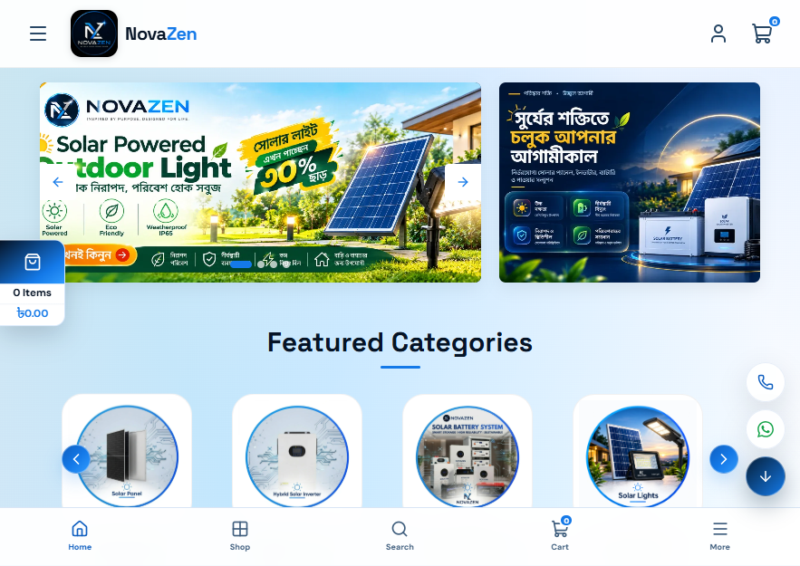 | 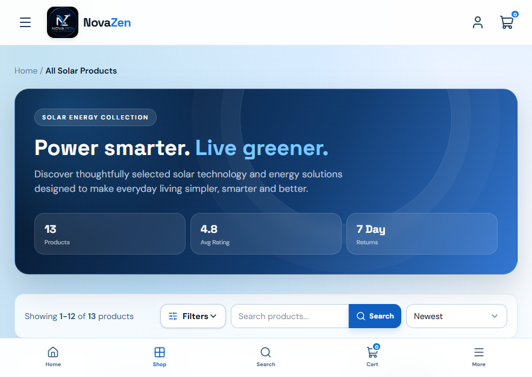 |

| Product details | Cart |
| --- | --- |
| 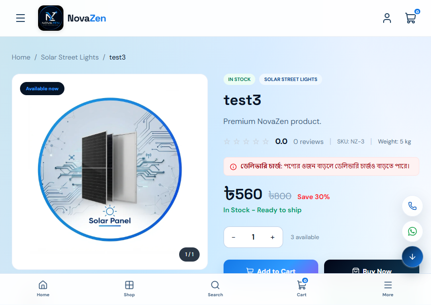 | 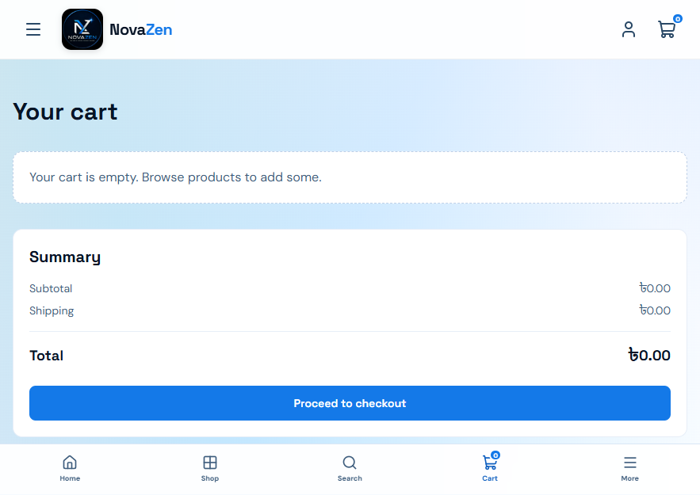 |

| Wishlist | Checkout |
| --- | --- |
| 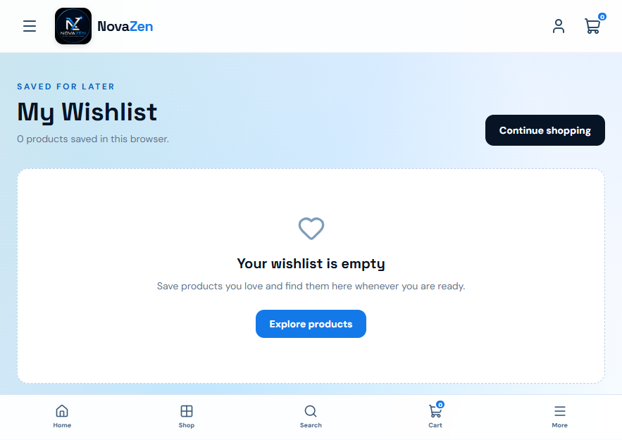 | 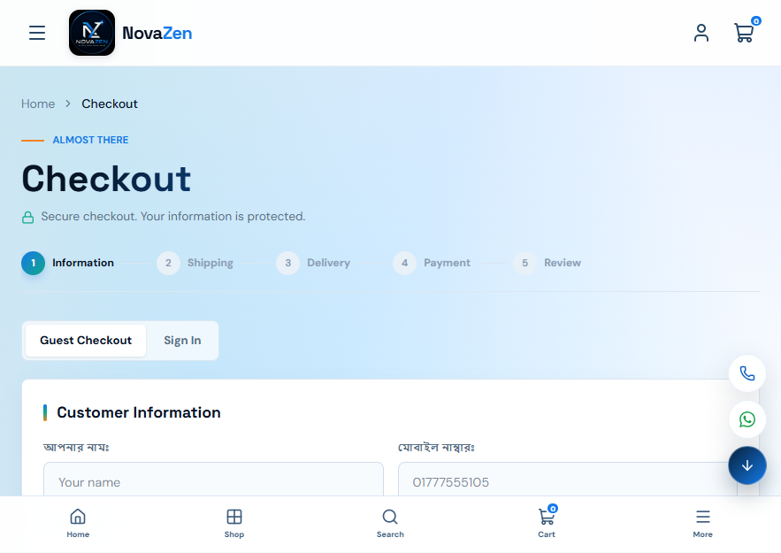 |

| Order tracking | Customer login |
| --- | --- |
| 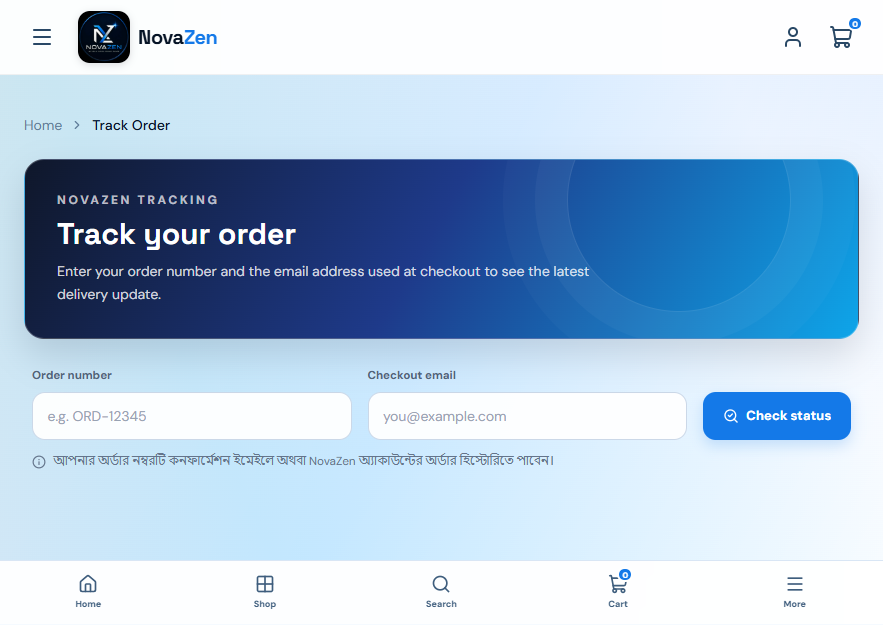 | 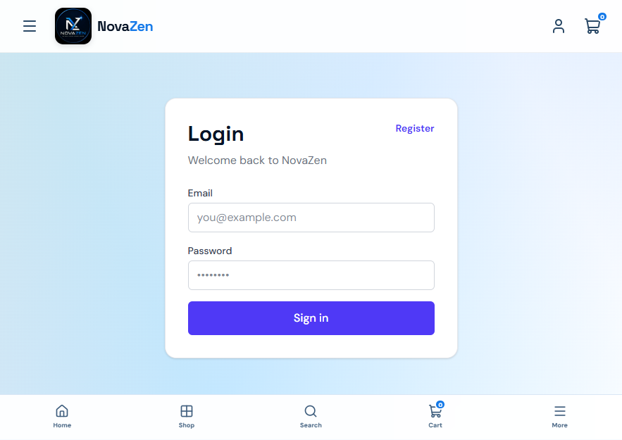 |

| Customer registration | About NovaZen |
| --- | --- |
| 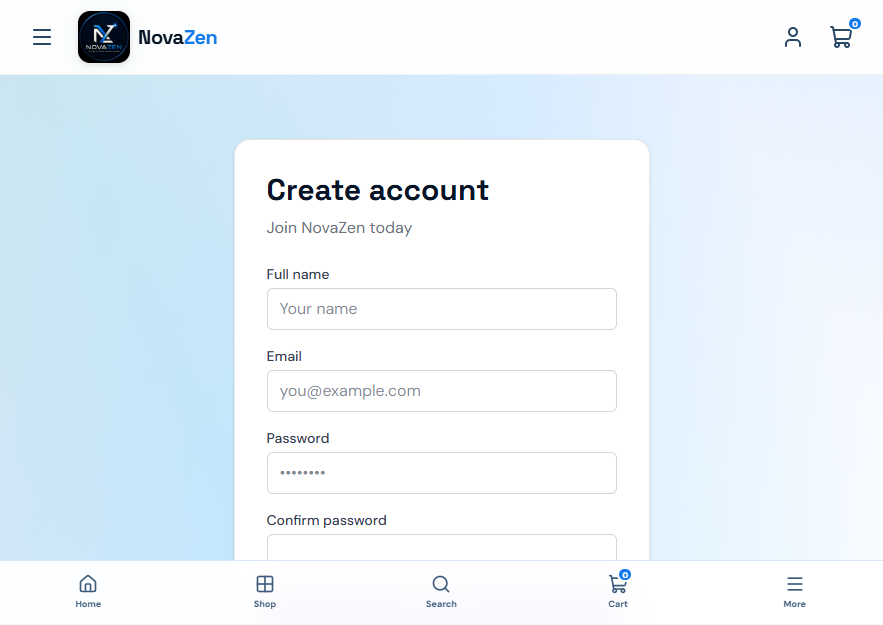 | 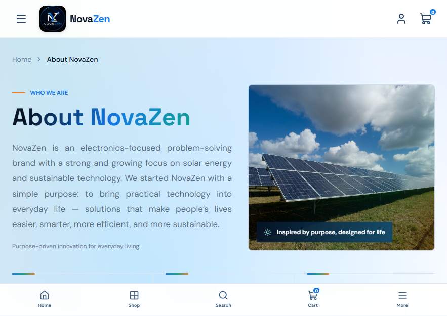 |

| FAQ | Contact |
| --- | --- |
| 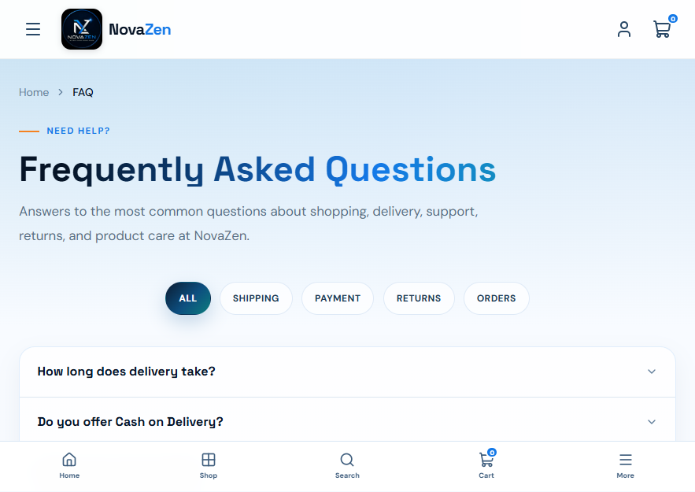 | 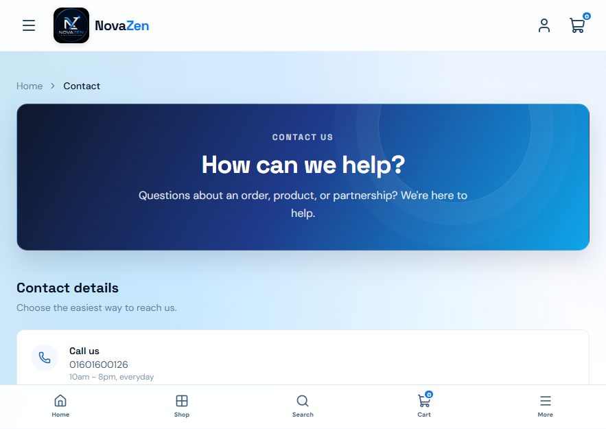 |

### Administration

| Product management | Category management |
| --- | --- |
| 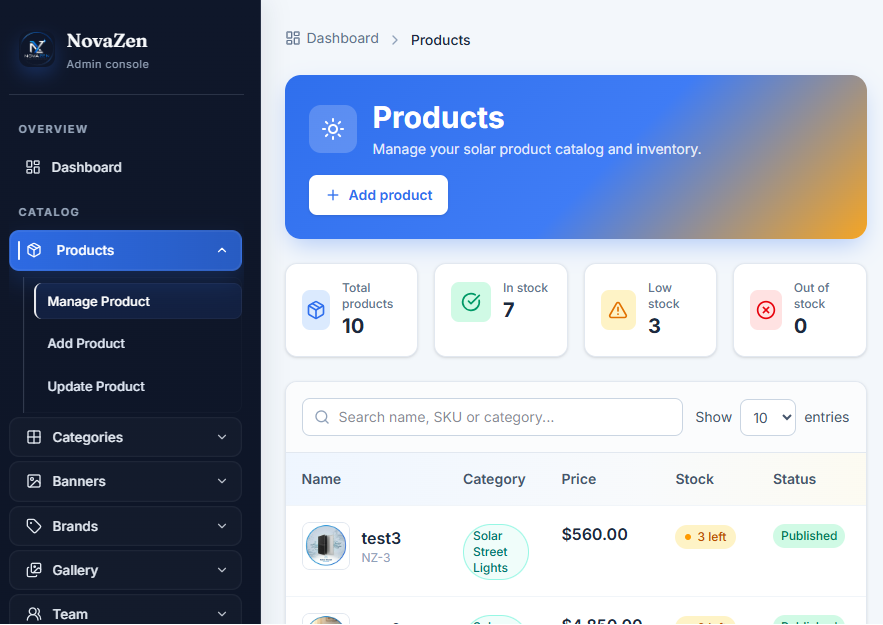 | 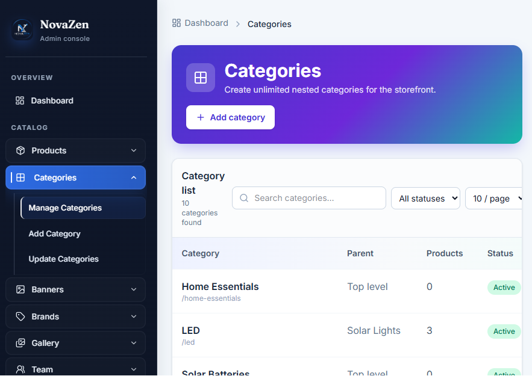 |

| Banner management | Order management |
| --- | --- |
| 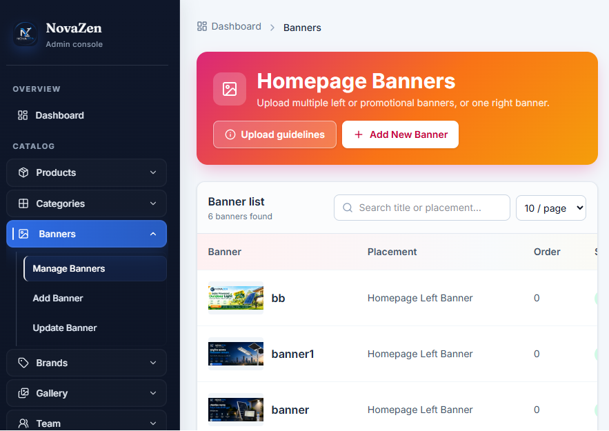 | 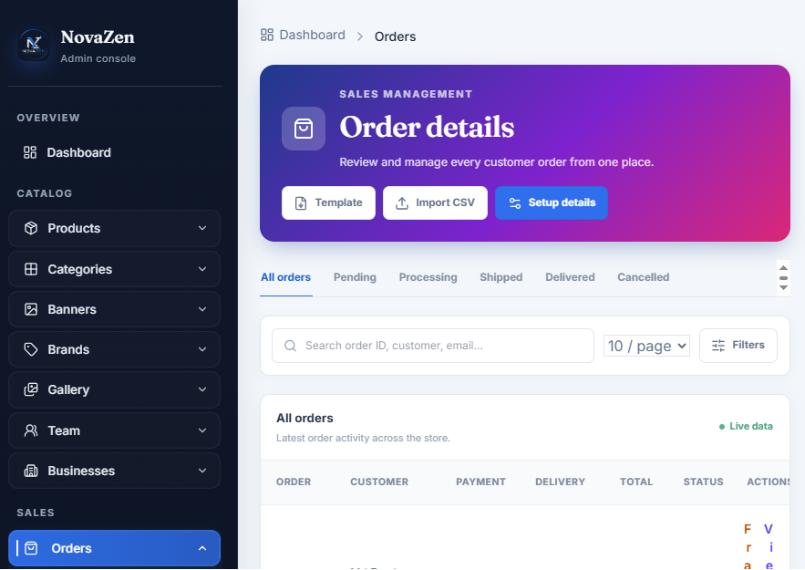 |

| Reports | Admin login |
| --- | --- |
| 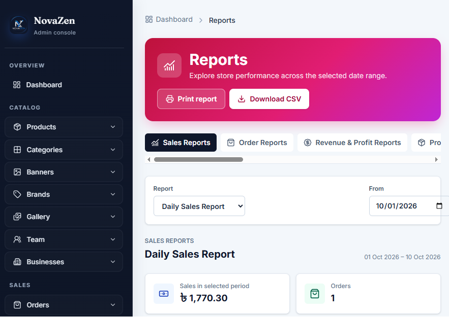 | 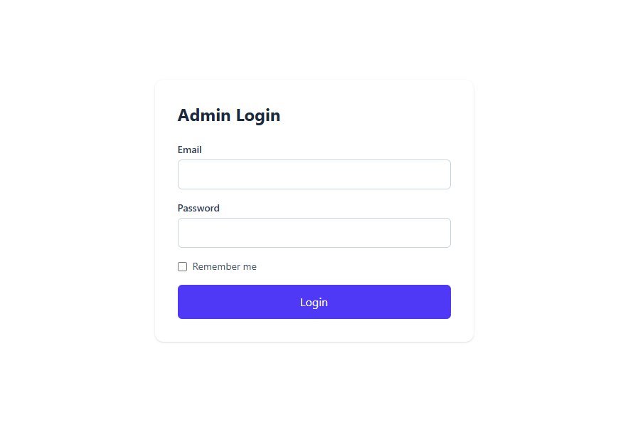 |

## Features

### Storefront and product catalog

- Responsive customer-facing storefront with homepage, shop, product details, about, FAQ, contact, and policy pages.
- Homepage content areas for promotional banners, categories, featured and top-selling products, flash sales, brands, reviews, team information, sister businesses, and gallery content.
- Product catalog with nested categories, brands, variants, SKU, price/compare price, stock quantity, weight, and multiple images.
- Product detail pages with image gallery, availability, reviews and ratings, FAQs, related products, and add-to-cart/buy-now actions.
- Shop search across product name, SKU, descriptions, and category; category selection includes descendant categories.
- Shop filters for maximum price, rating, and stock availability, plus sorting by newest, price, rating, and popularity.
- Offer-zone and flash-sale product sections based on active sale pricing.
- Responsive navigation, floating contact actions, and cart summary in the storefront.
- Product image uploads are stored on Laravel's configured filesystem. When supported GD/WebP functions are available, images can be resized and encoded as WebP; otherwise the original upload is retained.

### Cart, checkout, and orders

- Guest and signed-in customer cart workflows, including quantity updates, item removal, and coupon apply/remove.
- Wishlist add/remove and customer wishlist page.
- Coupon validation and application during shopping and checkout.
- Guest checkout and signed-in customer checkout with delivery/contact information.
- Cash-on-delivery and a demo online-payment flow. The demo payment page is for development/testing and is not a live payment gateway.
- Weight- and area-based shipping calculation. The current service uses a base rate of 70 for Dhaka and 130 outside Dhaka, plus 40 for each started kilogram after the first; review `app/Services/ShippingRateService.php` before changing these rates.
- Order confirmation, order history, order detail pages, and signed public order-tracking links.
- Customer address book and profile/password management.
- Customer order notifications with read, unread, open, and delete actions.
- Product reviews, including guest review support, recommendation flagging, and admin review moderation.

### Admin console and store operations

- Protected admin dashboard with store overview and operational shortcuts.
- Product administration for product details, categories, variants, inventory, images, and SEO data.
- Category, brand, banner, gallery, coupon, review, team-member, and sister-business management.
- Order list, order detail, manual order creation, order import, and downloadable import template.
- Order status, payment status, delivery status, and customer-note updates.
- Refund workflow and PDF invoice viewing/download.
- Order fraud-check report, including optional external courier history lookup.
- Optional Steadfast parcel creation with returned tracking code and consignment ID saved to the order.
- Customer, contact-message, newsletter-subscriber, and notification administration.
- Sales and customer reporting with report export.
- Homepage and page SEO settings, product SEO fields, and product URL redirect management.
- User, role, and permission administration.

### Roles and permissions

- Spatie Laravel Permission provides role and permission storage and checks.
- Seeded roles include `Customer`, `Store Admin`, `Marketing/Content Editor`, `Support Staff`, and `Super Admin`.
- Admin routes are protected by authentication and admin middleware, with route groups further gated by permissions.
- API administration routes require Sanctum authentication and the configured admin/role checks.

### Search, metadata, and indexing

- Editable homepage title, description, share image, verification value, and social profile URLs.
- Editable static-page metadata and product-specific SEO/social metadata.
- Product URL redirects for changed product slugs.
- Canonical URLs, robots directives, and structured data for the store, catalog pages, products, and breadcrumbs.
- Generated sitemap at `/sitemap.xml` and crawler rules at `/robots.txt`.

### API and external integrations

- Health check and versioned API routes under `/api/v1`.
- Public product, category, and page endpoints.
- Sanctum-based API registration, login, logout, and profile endpoints.
- Authenticated customer cart, checkout, orders, wishlist, and coupon endpoints.
- Authenticated admin dashboard and catalog endpoints.
- Optional BD Courier phone-based customer report lookup.
- Optional Steadfast parcel creation for eligible orders.
- Courier API keys and service URLs are read from environment configuration; credentials are not stored in source code.

## Technology stack

| Layer | Technology |
| --- | --- |
| Application framework | Laravel 12 |
| Backend language | PHP 8.2+ |
| Server-rendered UI | Laravel Blade, HTML, CSS, and JavaScript |
| CSS framework | Tailwind CSS 4 |
| Frontend bundler/dev server | Vite 7 with Laravel Vite Plugin |
| HTTP client utility | Axios |
| Authentication | Laravel web/session authentication and Laravel Sanctum for API access |
| Authorization | Spatie Laravel Permission plus application middleware |
| Persistence | Laravel Eloquent ORM and schema migrations |
| Local database default | SQLite; database connection is configurable through Laravel environment settings |
| Image processing | PHP GD and WebP when supported, with original-upload fallback |
| PDF generation | `barryvdh/laravel-dompdf` |
| Testing | PHPUnit 11 and Laravel's test runner |
| Developer tooling | Composer, npm, Laravel Pail, and Concurrently |

Dependency requirements and scripts are defined in `composer.json` and `package.json`.

## Requirements

- PHP 8.2 or later with the PHP extensions required by Laravel and installed Composer packages.
- Composer.
- Node.js and npm.
- A database supported by Laravel. `.env.example` is configured for SQLite for local development.
- PHP GD with WebP support is optional and is used for image optimization only; uploads fall back to the original file when it is unavailable.

## Local installation

The commands below use Windows PowerShell. Start from the repository root, then run:

```powershell
Set-Location backend
composer install
if (!(Test-Path .env)) { Copy-Item .env.example .env }
if (!(Test-Path database\database.sqlite)) { New-Item -ItemType File database\database.sqlite | Out-Null }
php artisan key:generate
php artisan migrate --seed
npm install
npm run build
php artisan storage:link
```

The database seeder creates starter permissions and roles, catalog examples, brands, gallery entries, and demo local accounts. Review `database/seeders/RolePermissionSeeder.php` for seeded account details. These accounts are for local development only: replace their credentials or remove them before exposing a deployment to the internet.

Start the development services with:

```powershell
composer run dev
```

This Composer script starts Laravel, a queue listener, Laravel Pail, and Vite together. The storefront is available at `http://127.0.0.1:8000`; the admin console is at `http://127.0.0.1:8000/admin`.

## Configuration

Configure environment-specific values in `backend/.env`. Do not commit `.env` files, API keys, application keys, or other credentials.

| Variables | Purpose |
| --- | --- |
| `APP_NAME`, `APP_ENV`, `APP_DEBUG`, `APP_URL` | Application identity, environment, debug behavior, and canonical URL. |
| `DB_CONNECTION`, `DB_DATABASE` and related `DB_*` values | Database driver and connection. The example uses SQLite. |
| `SESSION_DRIVER`, `CACHE_STORE`, `QUEUE_CONNECTION` | Session, cache, and queue backends. The example uses database-backed drivers for these services. |
| `MAIL_MAILER`, `MAIL_*` | Outbound mail configuration. The example uses the `log` mailer and does not send real email. |
| `FILESYSTEM_DISK` | Default upload/storage disk. The example uses the local disk. |
| `BDCOURIER_API_KEY`, `BDCOURIER_API_URL` | Optional BD Courier report service credentials and base URL. |
| `STEADFAST_API_KEY`, `STEADFAST_SECRET_KEY`, `STEADFAST_BASE_URL` | Optional Steadfast merchant credentials and API base URL. |

### Steadfast parcel workflow

Configure the three Steadfast environment values before using the integration. An admin with the `update orders` permission can create a parcel from an order. The order must have a valid Bangladesh mobile number, recipient name, and delivery address. Online-payment orders must be marked paid first. COD orders send the order grand total as the COD amount; paid online orders send a zero COD amount. If a connection fails, verify the invoice in the courier merchant dashboard before retrying to avoid duplicate parcels.

## API overview

Laravel automatically serves `routes/api.php` under the `/api` prefix.

| Method | Endpoint | Access |
| --- | --- | --- |
| `GET` | `/api/health` | Public |
| `POST` | `/api/v1/auth/register` | Public |
| `POST` | `/api/v1/auth/login` | Public |
| `GET` | `/api/v1/products` | Public |
| `GET` | `/api/v1/products/{slug}` | Public |
| `GET` | `/api/v1/categories` | Public |
| `GET` | `/api/v1/pages/{slug}` | Public |
| `POST` | `/api/v1/auth/logout` | Sanctum authenticated |
| `GET` | `/api/v1/auth/profile` | Sanctum authenticated |
| `POST` | `/api/v1/cart/add` | Sanctum authenticated |
| `POST` | `/api/v1/checkout` | Sanctum authenticated |
| `GET` | `/api/v1/orders` | Sanctum authenticated |
| `GET` | `/api/v1/wishlist` | Sanctum authenticated |
| `POST` | `/api/v1/coupon/apply` | Sanctum authenticated |
| `GET` | `/api/v1/admin/dashboard` | Authenticated admin |
| `GET`, `POST` | `/api/v1/admin/categories` | Authenticated `Store Admin` |
| `GET`, `POST` | `/api/v1/admin/products` | Authenticated `Store Admin` |
| `PUT`, `DELETE` | `/api/v1/admin/products/{product}` | Authenticated `Store Admin` |

This is a feature overview, not an exhaustive API specification. Check `routes/api.php` for the current route definitions and middleware.

## Development and testing

Run these commands from `backend/`:

```powershell
php artisan route:list
php artisan migrate
php artisan migrate --seed
composer test
npm run build
```

The PHPUnit configuration uses an in-memory SQLite database for automated tests.

## Production checklist

- Set `APP_ENV=production`, `APP_DEBUG=false`, a unique `APP_KEY`, and the correct `APP_URL`.
- Configure production database, mail, queue, cache, session, and filesystem services in environment variables.
- Never expose or reuse development seeder accounts in production; create secure administrator credentials.
- Build frontend assets with `npm run build`.
- Apply production migrations using `php artisan migrate --force`.
- Configure the web server document root to the Laravel `public/` directory.
- Ensure `storage/` and `bootstrap/cache/` are writable by the web-server user.
- Run `php artisan storage:link` where public-disk uploads should be served through Laravel's public storage link.
- Configure and monitor a production queue worker if queued jobs are used.
- Keep backups of the database and uploaded files, and do not commit `.env` or credentials.

## License

The project declares the MIT license in `composer.json`.
